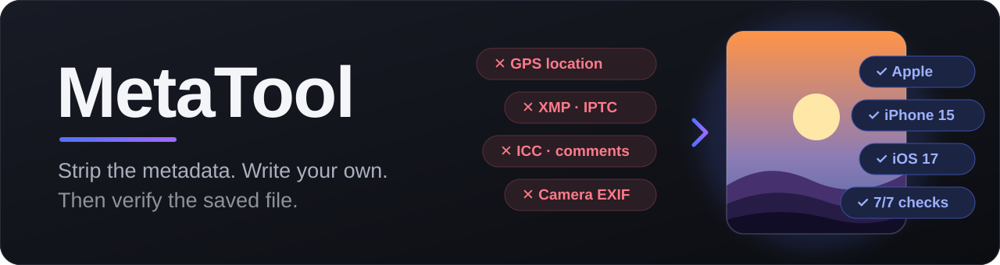
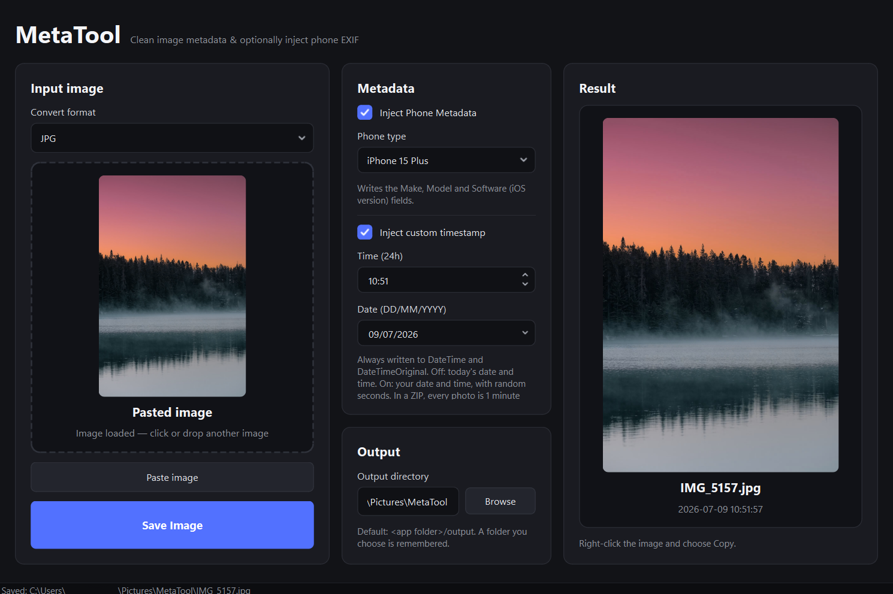
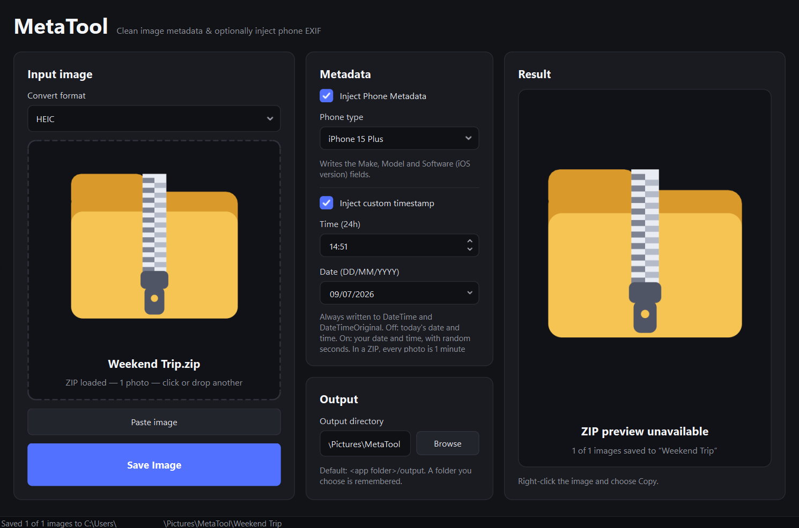
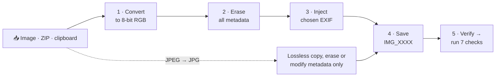
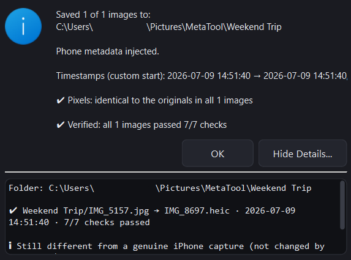

<p align="center">
  
</p>

<p align="center">
  
  
  
  
  
</p>

<h3 align="center">A small desktop tool that wipes a photo's metadata, writes only the metadata you choose, and then checks the saved file.</h3>

<p align="center">
  
</p>

---

## ✨ Features

- **Drop, click or paste.** Drag an image or a ZIP onto the window, click to browse, or press **Paste image** to use what is on the clipboard (a copied picture, or a copied image / ZIP file).
- **Converts to JPG or HEIC.** Reads JPG, PNG, WebP, TIFF, BMP, GIF and HEIC/HEIF. Output files are named like an iPhone's: `IMG_0001` to `IMG_9999`, with a random number that is never already taken in the folder (nothing is ever overwritten).
- **Strips everything identifying.** EXIF, GPS, XMP, IPTC, ICC profiles, comments, PNG text chunks and thumbnails never reach the output.
- **Writes only what you choose.**
  - *Phone metadata (optional):* Make, Model and Software (iOS version) for any of **54 iPhone models**, from the original iPhone to the iPhone 17 series and beyond.
  - *Timestamp (always):* `DateTime` and `DateTimeOriginal`. Unchecked = today's date and time. **Inject custom timestamp** = your date (`DD/MM/YYYY`) and `HH:mm`, with random seconds.
- **ZIP batches.** Every photo in the archive is processed into `<output folder>/<zip name>/`, one minute apart, with random seconds.
- **Result preview.** The saved image appears on the right. Right-click → **Copy** puts the full-resolution image *and* the file on the clipboard.
- **Verifies every save.** The saved file is re-opened and put through 7 independent checks ([details](#-the-7-verification-checks)).
- **Remembers your settings** in `settings.json`, and ships with a dark theme (including the Windows title bar).

<p align="center">
  
</p>

## 🚀 Quick start

- Install to your pc from the installer in the latest [release](/releases) (Recommended)
```bash
Download MetaTool_Setup_vx.x.x.exe
Run it to install the app
An icon should appear on the desktop
Double-Click on the icon to run MetaTool
```

- Download a portable (.zip) version available in the latest [release](/releases)
```bash
Download MetaTool_Portable_vx.x.x.zip
Unzip it using WinRAR (Recommended) or 7zip
Open the unzipped folder
Right-Click MetaTool.exe, click "Send to" then "Desktop (create shortcut)"
Rename the desktop shortcut to "MetaTool" and it's ready to use
```

- Running from the source code
```bash
git clone <your-repo-url>
cd MetaTool
python -m venv .venv
.venv\Scripts\activate          # Windows  (macOS/Linux: source .venv/bin/activate)
pip install -r requirements.txt
python main.py
```

**Requirements:** Python 3.10+, PyQt6, Pillow, pillow-heif, piexif (all in `requirements.txt`).

## 🛠️ Usage
1. Drop a photo (or a ZIP) into the rectangle, or click **Paste image**.
2. Pick **JPG** or **HEIC**, and tick the metadata however you want.
3. Click **Save Image**. Files land in `Pictures/MetaTool` unless you pick another folder with **Browse**.
4. Saved image also appears in **Preview Image** field where you can right-click → copy the modified image

## 🧭 How it works



- **Erase** copies only pixel data onto a brand-new canvas, so nothing from the original file can be carried over.
- **JPEG → JPG shortcut:** a JPEG is not decoded and re-encoded at all. Its compressed image data is copied byte for byte and only the metadata segments are erased.
- **Inject** writes a minimal EXIF block with only the fields above.

## 🎚️ Image quality

No quality loss is introduced unless a format makes it unavoidable. The app tells you which case you are in after every save.

| You convert… | …to | Result |
|---|---|---|
| a **JPEG** | JPG | **Identical pixels.** The compressed data is copied, nothing is re-encoded. |
| **anything** | HEIC | **Bit-exact (lossless).** 4:4:4 chroma with the identity colour matrix, so every pixel round-trips unchanged. |
| PNG, WebP, TIFF, BMP, GIF, HEIC | JPG | **Near-lossless, not exact.** JPEG cannot store arbitrary pixels, so the highest setting is used (quality 100, 4:4:4). The largest per-channel error was 4 out of 255 in tests, and the dialog reports the real figure. Choose HEIC if you need exact pixels. |

A few cases must change data, and the dialog says so when they happen: transparency is flattened onto white, 16-bit data is scaled to 8-bit, CMYK is converted to RGB.

> The source's ICC colour profile is removed (that is the point of stripping). Pixel values stay identical, but wide-gamut images can look different in colour-managed viewers.

## 🧪 The 7 verification checks

After each save the file is read back from disk and checked:

| # | Check |
|---|---|
| 1 | Opens and decodes as a valid JPEG / HEIC image |
| 2 | Pixel size is unchanged by the conversion |
| 3 | Container holds exactly one Exif block and no XMP / ICC / IPTC / comment segments |
| 4 | EXIF holds exactly the intended fields (with the right values) and nothing else |
| 5 | No GPS, thumbnail or other EXIF blocks |
| 6 | `DateTime` equals `DateTimeOriginal` and matches the intended timestamp |
| 7 | None of the original file's metadata values appear anywhere in the output |

The dialog's **Show Details…** panel lists every check, plus one informational note on what still differs from a genuine iPhone capture.

<p align="center">
  
</p>

You can also inspect any file from the command line:

```bash
python -m core.verify photo.jpg      # segments, container items and every EXIF field
```

## 📦 ZIP archives

- Photos are processed in natural name order (`photo2` before `photo10`).
- Folders, `__MACOSX`, `.DS_Store` and non-image files are skipped; a corrupt or password-protected image is reported without stopping the rest, and never takes a timestamp slot.
- **Custom timestamp:** the first photo gets your time, each next one a minute later.
- **Today's date and time:** the last photo is "now" and earlier ones go back a minute each, so no photo ends up in the future.
- Safety limits: 2000 images per archive, 300 MB per image, 3 GB in total. Images are read in memory; nothing is extracted to disk.

## ⚙️ Settings

Saved to `settings.json` next to the app (or `~/.metatool/` if that folder is read-only) every time you change something:

| Key | Meaning |
|---|---|
| `output_format` | `"JPG"` or `"HEIC"` |
| `inject_metadata`, `phone_model` | Phone metadata on/off and the chosen model |
| `inject_timestamp`, `timestamp_date`, `timestamp_time` | Custom timestamp on/off, `YYYY-MM-DD`, `HH:mm` |
| `output_dir` | `null` = `<app folder>/output`, otherwise your chosen folder |
| `window_width`, `window_height` | Last window size |

## 🔨 Build a standalone `.exe`

```bash
pip install cx_Freeze
python core/setup.py build        # -> build/MetaTool/MetaTool.exe
```

The build is deliberately lean. It bundles only QtCore / QtGui / QtWidgets, the Windows platform plugin, the ICO image plugin, the Pillow code for the formats above, `pillow-heif` and `piexif`, and prunes every other Qt library and plugin. Put your `icon.ico` in the project root: it becomes the `.exe` icon and the icon of every window. Without it the build still works and prints a warning.

## 🗂️ Project layout

```
MetaTool/
├── main.py              # entry point
├── requirements.txt
├── icon.ico             # your icon (optional)
├── settings.json        # created at runtime
├── assets/              # README images
└── core/
    ├── ui.py            # window, drop zone, result preview, dialogs
    ├── processor.py     # convert → strip → inject → save, ZIP batches
    ├── verify.py        # the 7 post-save checks (+ CLI)
    ├── iphone_models.py # model → iOS version table
    ├── settings.py      # JSON settings
    ├── theme.py         # dark theme, icons, window chrome
    └── setup.py         # cx_Freeze build script
```

## ⚠️ Good to know

- **It edits metadata; it does not make a camera original.** Real iPhone photos also carry exposure and lens data, a MakerNote, GPS, an ICC profile, a thumbnail and Apple's own encoder output. None of that is written here.
- **Lossless HEIC is 4:4:4 with brand `heix`**, not the 4:2:0 `heic` an iPhone writes, and not every viewer can open it. Open it in your target viewer before relying on it.
- **A rotated JPEG** keeps its `Orientation` tag when copied losslessly (the pixels are not rotated), so it still displays upright. It is the one extra EXIF field you can see.
- The **dark title bar** is Windows-only; everything else is plain Python and Qt.

## 🤝 Responsible use

MetaTool is for privacy (removing location and device data before sharing) and for testing and creative work. Please don't use it to present edited or generated images as authentic photographs where authenticity matters.
